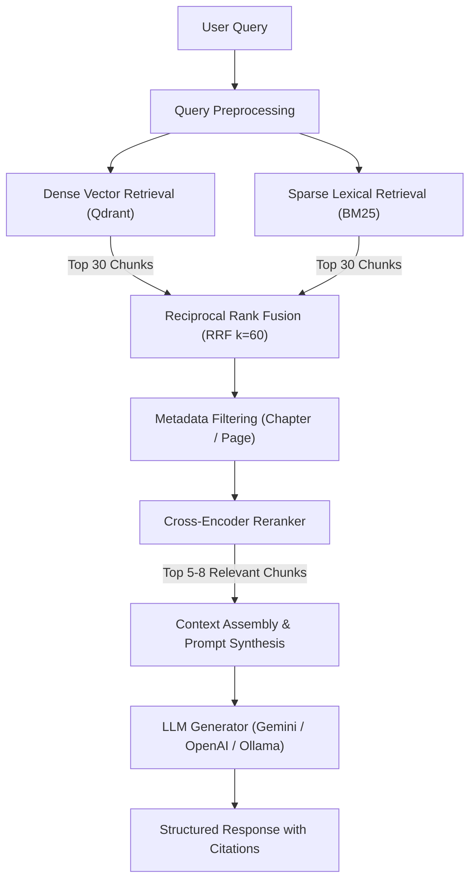

# 📘 AI Engineering Book — Advanced Hybrid RAG System

An end-to-end Retrieval-Augmented Generation (RAG) system built for the digital book **"AI Engineering"**.

This application preserves the original book's structure and knowledge, featuring structure-aware chunking, dense + lexical hybrid retrieval with Reciprocal Rank Fusion (RRF), cross-encoder reranking, and hallucination-free answer generation with verifiable physical PDF page citations.

---

## 🌟 Key Capabilities

1. **Grounded Question Answering**: Conversational assistant strictly adhering to retrieved book content, citing chapter, section, and original physical PDF page numbers.
2. **Structure-Aware Ingestion & Chunking**: Preserves chapter headings, code blocks, and markdown tables. Respects sentence boundaries and avoids naive fixed-character truncation.
3. **Multi-Stage Hybrid Retrieval**:
   - **Dense Vector Search**: Configurable embeddings stored in **Qdrant**. The default `local_fast` provider uses lightweight word unigram/bigram feature hashing; use a trained embedding provider such as BGE-M3 for semantic similarity.
   - **Sparse Lexical Search**: **BM25Okapi** keyword index for exact technical terminology and identifiers.
   - **Reciprocal Rank Fusion (RRF)**: Rank aggregation combining dense and sparse candidates with \( k = 60 \).
   - **Cross-Encoder Reranking**: Second-stage fine-grained cross-scoring of top fused candidates.
4. **Original PDF Page Preservation**: All citations point to the original physical PDF page numbers (1-indexed), never chunk indices.
5. **Multi-Perspective Learning Assistant**: Explanations tailored for Beginner, Intermediate, and Expert levels, plus automated quiz generation.
6. **Concept Comparison & Summarization**: Structured side-by-side architecture comparisons (e.g. *RAG vs Fine-Tuning*) and executive chapter summaries.
7. **Comprehensive Evaluation Suite**: Measures Context Precision, Context Recall, Faithfulness, Answer Relevance, Retrieval Precision/Recall, Citation Accuracy, and Latency.

---

## 🏗️ Architecture Workflow



---

## 📁 Project Structure

```
ai-engineering-rag/
├── app.py                      # Main Streamlit web application
├── requirements.txt            # Dependency specification
├── .env.example                # Sample environment configuration
├── README.md                   # System documentation
│
├── backend/
│   ├── main.py                 # FastAPI application with REST endpoints
│   ├── config.py               # Pydantic v2 settings & path resolution
│   ├── schemas.py              # Data contracts and API models
│   │
│   ├── ingestion/              # PDF extraction and document processing
│   │   ├── pdf_loader.py       # Streaming PyMuPDF page loader
│   │   ├── document_parser.py  # Cache-enabled document parser
│   │   ├── ocr_processor.py    # Scanned page detection and OCR fallback
│   │   └── metadata_extractor.py # Heading detection & running header/footer cleaner
│   │
│   ├── chunking/
│   │   └── chunker.py          # Structure-aware chunker (code, tables, headings)
│   │
│   ├── embeddings/
│   │   └── embedding_service.py # Configurable embeddings (LocalFast, BGE-M3, OpenAI)
│   │
│   ├── vectorstore/
│   │   └── qdrant_store.py     # Qdrant vector database store & cosine search
│   │
│   ├── retrieval/              # Hybrid retrieval pipeline
│   │   ├── bm25_search.py      # BM25Okapi keyword index with persistence
│   │   ├── vector_search.py    # Dense semantic search client
│   │   ├── reranker.py         # Cross-Encoder reranker
│   │   └── hybrid_search.py    # Reciprocal Rank Fusion (RRF) coordinator
│   │
│   ├── generation/             # LLM response generation
│   │   ├── llm_service.py      # OpenAI-compatible / Gemini / Ollama / Fallback service
│   │   └── prompt_templates.py # Grounding rules & 5-part answer formatting
│   │
│   ├── rag/
│   │   └── rag_pipeline.py     # End-to-end RAG orchestrator & chapter navigator
│   │
│   ├── evaluation/             # Evaluation & observability
│   │   ├── evaluator.py        # 7-metric evaluation runner
│   │   └── test_dataset.py     # Golden benchmark test dataset
│   │
│   └── utils/
│       └── helpers.py          # Utilities and sample book generator
│
├── frontend/
│   ├── components/
│   │   ├── sidebar.py          # Modern navigation sidebar
│   │   ├── chat_view.py        # Conversational UI with citation cards
│   │   └── source_card.py      # Expandable source evidence inspector
│
├── data/
│   ├── uploads/                # Directory for uploaded book PDFs
│   ├── processed/              # Ingestion cache (JSON parsed pages)
│   └── evaluation/             # Persisted evaluation benchmark reports
│
├── storage/
│   ├── qdrant/                 # Persistent local Qdrant vector database
│   └── bm25_index.pkl          # Serialized BM25 inverted index
│
└── tests/
    ├── test_ingestion.py       # Ingestion & page streaming tests
    ├── test_chunking.py        # Structure-aware chunking tests
    ├── test_retrieval.py       # BM25, Qdrant & RRF hybrid search tests
    └── test_rag.py             # End-to-end RAG and evaluation tests
```

---

## 🚀 Quick Start Guide

### 1. Prerequisites
- **Python**: 3.11, 3.12, 3.13, or 3.14.
- Git (optional).

### 2. Installation

Clone or enter the directory:
```bash
cd "ai-engineering-rag"
```

Install requirements:
```bash
pip install -r requirements.txt
```

### 3. Environment Configuration

Copy `.env.example` to `.env`:
```bash
cp .env.example .env
```

The app loads `.env`; `.env.example` is only a template. Put your real API key in `.env` and keep the example key as a placeholder.

The template defaults to Groq. Configure your preferred LLM in `.env`:
```ini
# Groq
LLM_PROVIDER=groq
LLM_MODEL=openai/gpt-oss-120b
GROQ_API_KEY=your_groq_api_key_here
LLM_BASE_URL=https://api.groq.com/openai/v1

# Google Gemini alternative (native Interactions API)
# LLM_PROVIDER=gemini
# LLM_MODEL=gemini-3.8-flash
# LLM_API_KEY=your_gemini_api_key_here

# For OpenAI
# LLM_PROVIDER=openai
# LLM_MODEL=gpt-4o
# LLM_API_KEY=your_openai_api_key_here

# For Local Ollama
# LLM_PROVIDER=ollama
# LLM_MODEL=llama3.1
# LLM_BASE_URL=http://localhost:11434/v1
```
*Note: If no API key is provided, the system automatically uses the internal `FallbackOfflineLLMService` to generate structured grounded responses for offline use and testing.*

---

## 🏃 Running the Application

### Option A: Launch Streamlit UI
```bash
streamlit run app.py
```
Open your browser at `http://localhost:8501`.

### Option B: Launch FastAPI Backend Server
```bash
uvicorn backend.main:app --host 0.0.0.0 --port 8000 --reload
```
Interactive Swagger API documentation is available at `http://localhost:8000/docs`.

---

## 📚 Document Ingestion

1. Navigate to **📂 Document Management** in the Streamlit UI.
2. Upload your `AI_Engineering.pdf` file (up to 991+ pages) and click **Save & Ingest**.
3. *Alternatively*, click **⚡ Generate & Ingest 35-Page Sample Book** to instantly explore the system with a multi-chapter technical book containing code snippets, tables, and architectural diagrams.

---

## 🧪 Running Automated Tests

Run the complete test suite with `pytest`:
```bash
pytest -v
```

All 12 automated unit and integration tests will verify:
- Page streaming and 1-indexed PDF page numbering
- Running header/footer stripping and OCR detection
- Structure-aware chunking and code block protection
- BM25 and Qdrant dense vector search
- Reciprocal Rank Fusion (RRF)
- Answer generation, citation parsing, summarization, and concept comparison
- Evaluation metrics calculation

---

## 📊 Evaluation Framework

The system includes a golden benchmark dataset (`backend/evaluation/test_dataset.py`) covering core AI engineering topics.

To run the evaluation:
1. Open the **📊 Evaluation Dashboard** in Streamlit.
2. Click **🚀 Run Comprehensive Evaluation Benchmark**.

The dashboard measures and reports:
- **Context Precision** (Threshold: $\ge 70\%$)
- **Context Recall** (Threshold: $\ge 75\%$)
- **Faithfulness / Groundedness** (Threshold: $\ge 85\%$)
- **Answer Relevance** (Threshold: $\ge 75\%$)
- **Retrieval Precision & Recall**
- **Citation Accuracy** (Threshold: $\ge 90\%$)
- **Average Latency (ms)**

---

## 🛡️ Security & Reliability Features
- **Zero API Key Leakage**: Keys are read from environment variables or password-masked UI inputs.
- **Path Sanitization**: Restricts all uploads strictly to `data/uploads/`.
- **Safe Content Caching**: Caches parsed pages by file SHA-256 hash to prevent redundant extraction overhead on large PDFs.
- **Fail-Safe Fallbacks**: Works both online with API LLMs and offline with deterministic synthesizers.
